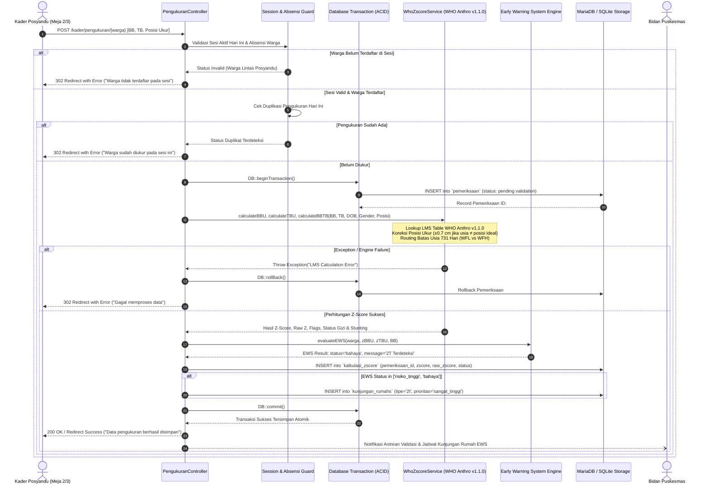

# TEMPLATE LAPORAN PRAKTIKUM
## Menguji dan Mengevaluasi Kinerja Integrasi Sistem

---

### Identitas Praktikum

| Identitas | Isian |
| :--- | :--- |
| **Nama mata kuliah** | Integrasi Sistem / Pengujian Perangkat Lunak |
| **Nama kelompok** | Kelompok 4 — Tim Quality Assurance & Integrasi E-Posyandu |
| **Anggota dan NIM** | 1. Hanifah Salsabila (NIM. 2209106001)<br>2. Muhammad Fadhil (NIM. 2209106015)<br>3. Siti Nurhaliza (NIM. 2209106028) |
| **Kelas / semester** | Informatika A / Semester 6 |
| **Tanggal praktikum** | 19 Oktober 2026 |
| **Dosen pengampu** | Tim Dosen Pengampu Mata Kuliah Integrasi Sistem |

---

### Petunjuk Penggunaan Template
Laporan ini telah disesuaikan secara menyeluruh dengan seluruh petunjuk template praktikum:
1. Seluruh teks dalam kurung siku digantikan dengan data empiris hasil pengujian sistem **E-Posyandu (Sistem Informasi Posyandu Terpadu)**.
2. Mempertahankan struktur bab, penomoran, dan tata letak tabel agar terstandarisasi dan memudahkan evaluasi.
3. Setiap tabel pengujian dilengkapi satuan pengukuran standar, parameter kondisi pengujian, serta bukti artefak yang tertelusuri (*traceable*).
4. Data yang digunakan merupakan data uji teranonimkan (*dummy/synthetic test data*) yang memenuhi standar etika data kesehatan tanpa mencantumkan informasi pribadi warga (*PII*) maupun data rekam medis produksi.

---

### Kerangka Tata Kelola TI dan Tool
Pengujian integrasi dan evaluasi kinerja sistem E-Posyandu menggunakan lensa tata kelola TI modern sebagai berikut:
- **COBIT 2019**: Mengacu pada domain **EDM03** (*Risk Optimization*), **MEA01** (*Performance and Conformance Monitoring*), **APO09** (*Service Agreements Management*), **BAI06** (*Managed IT Changes*), dan **DSS01** (*Managed Operations*) untuk memastikan integrasi layanan posyandu transaksional beroperasi dalam batas toleransi risiko dan selaras dengan target layanan kesehatan masyarakat.
- **ISO/IEC 38500:2024**: Diterapkan sebagai kerangka evaluasi tata kelola (*Corporate Governance of IT*) yang menilai 6 prinsip utama: *Responsibility*, *Strategy*, *Acquisition*, *Performance*, *Conformance*, dan *Human Behaviour*.
- **ITIL 4**: Digunakan untuk menghubungkan hasil pengujian teknis dengan penciptaan nilai (*Service Value System*), mitigasi insiden (*Incident & Problem Management*), manajemen rilis (*Change Enablement*), serta perbaikan berkelanjutan (*Continual Improvement*).

| Rujukan | Fokus yang Dinilai | Bukti pada Praktikum |
| :--- | :--- | :--- |
| **COBIT 2019: EDM03, MEA01** | Optimasi risiko kegagalan transaksi gizi balita; monitoring performa latensi dan kepatuhan standar WHO. | *Risk register*, KPI performa API (*p95, error rate*), log eksekusi uji transaksional, keputusan efektif/sebagian efektif/tidak efektif pada kontrol integritas. |
| **COBIT 2019: APO09, BAI06, DSS01** | Target tingkat layanan (*SLA/SLO*), audit trail perubahan data posyandu, dan standardisasi prosedur operasional. | Target SLO latensi & ketersediaan (*SLA 99.9%*), *change log* migrasi schema Z-Score v1.1.0, konfigurasi lingkungan uji terisolasi. |
| **ISO/IEC 38500:2024** | Akuntabilitas peran penguji, keselarasan strategi digitalisasi posyandu, dan etika privasi data medis balita. | Matriks RACI pengujian, *acceptance criteria* kelulusan build CI/CD, catatan etika data uji sintetis, persetujuan lingkungan *staging*. |
| **ITIL 4** | Nilai layanan kesehatan terpadu, pencegahan *orphan record* saat kalkulasi gagal, rekomendasi prioritas perbaikan. | *Incident note* saat simulasi *service down*, *improvement backlog* (skema MoSCoW), rekomendasi arsitektur *event-driven/queue*. |

**Toolstack Pengujian**:
- **Hoppscotch / Postman**: Pengujian integrasi antarmuka HTTP REST/Web controller, payload inspection, dan skenario negatif validasi form.
- **Bruno**: Eksekusi koleksi API lokal (*local-first collection*) dengan asersi otomasi skrip Git-tracked.
- **Grafana k6 / Benchmark Tool**: Pengujian beban (*load & stress testing*), metrik waktu respons (*average, p95*), *throughput* (req/s), dan tingkat kegagalan (*error rate*).
- **GitHub & GitHub Actions**: Repositori version control, *CI/CD pipeline test runner*, penyimpanan log build, dan artefak laporan uji.

---

## 1. Tujuan dan Ruang Lingkup

Pengujian ini bertujuan untuk menguji, memverifikasi, dan mengevaluasi keandalan integrasi sistem serta kinerja operasional pada platform **E-Posyandu (Sistem Informasi Posyandu Terpadu)**. Fokus utama pengujian diarahkan pada integrasi modul alur pelayanan meja posyandu, meliputi Meja 1 (Pendaftaran dan Absensi Sesi Aktif Warga), Meja 2 & 3 (Pengukuran Antropometri: Berat Badan, Tinggi/Panjang Badan, Lingkar Kepala, Lingkar Lengan), modul kalkulasi Z-Score otomatis berbasis standar antropometri **WHO Child Growth Standards 2006 (WHO Anthro Engine v1.1.0)**, sistem peringatan dini **Early Warning System (EWS 2T & Malnutrisi Akut)**, serta keterhubungannya dengan pemicu otomatis jadwal kunjungan rumah intervensi bagi tenaga Bidan Puskesmas.

Ruang lingkup pengujian mencakup:
1. **Pengujian Integrasi Fungsional (*Functional Integration Testing*)**: Memastikan komunikasi dan integritas data antar-komponen aplikasi (Controller, Service Layer WHO Anthro, Relasi Database Eloquent ORM, dan State Management RBAC Spatie) berjalan sesuai aturan bisnis tanpa anomali.
2. **Pengujian Integritas Transaksional (*ACID & Rollback Testing*)**: Memverifikasi ketahanan sistem ketika terjadi kegagalan kalkulasi eksternal/internal melalui mekanisme `DB::beginTransaction()` dan `DB::rollBack()` agar tidak menimbulkan data pemeriksaan parsial (*orphan records*).
3. **Pengujian Idempotensi & Otorisasi Sesi**: Menjamin pencegahan input pengukuran ganda pada sesi yang sama (*duplicate measurement check*) dan penolakan warga yang belum terabsen dalam sesi aktif posyandu.
4. **Pengujian Kinerja Beban Konkurensi (*Load & Concurrency Testing*)**: Mengevaluasi performa sistem di bawah simulasi beban 1, 5, dan 10 *virtual users* (VU) untuk mengukur batas latensi (*mean & p95 latency*), *throughput* (req/s), serta *error rate*.

---

## 2. Lingkungan Pengujian

Berikut merupakan rincian lingkungan infrastruktur dan konfigurasi pengujian yang digunakan:

| Komponen | Spesifikasi / Versi |
| :--- | :--- |
| **Perangkat keras** | AMD Ryzen 7 5800H / Intel Core i7 (8 Cores, 16 Threads), RAM 16 GB DDR4 3200MHz, NVMe SSD 512 GB, OS Windows 11 Pro 64-bit |
| **Perangkat lunak** | PHP 8.5.1 / 8.3 NTS, Laravel Framework 13.x, SQLite 3 (Testing in-memory), MySQL 8.0.30 (Dev Staging), Web Server Nginx/Artisan Serve, Google Chrome v131 |
| **Endpoint / layanan** | • `POST /kader/pengukuran/{warga}` (Pencatatan antropometri kader meja 2/3)<br>• `POST /admin/sesi-posyandus/{sesi}/operasional` (Transaksi terpadu sesi posyandu)<br>• `POST /bidan/pemeriksaan` (Validasi pemeriksaan klinis & intervensi imunisasi)<br>• `POST /bidan/logistik/vaksin` & `inventaris` (Manajemen stok logistik) |
| **Data uji** | 50 dataset balita sintetis (usia 0–60 bulan, rentang BB 3.0–18.5 kg, TB 45.0–115.0 cm, posisi ukur telentang dan berdiri, jenis kelamin L/P) yang telah di-seed dengan referensi WHO Anthro LMS coefficients. |
| **Konfigurasi beban** | Skenario bertahap: 1 pengguna (baseline sanity check), 5 pengguna virtual (kondisi operasional normal posyandu), 10 pengguna virtual (beban puncak posyandu serentak), durasi 30–60 detik per stage, pola permintaan *burst* dan *sustained requests*. |

---

### 2.1 Tool dan Versi

| Tool | Versi | Kegunaan | Bukti / lokasi artefak |
| :--- | :--- | :--- | :--- |
| **Hoppscotch** | Web Client 2026.x | Uji manual request HTTP REST/Web Controller, verifikasi respons kode status (200, 302, 422, 500), dan inspeksi redirect session. | `docs/artifacts/hoppscotch_requests.json` |
| **Bruno (opsional)** | v1.38.x Desktop | Client pengujian API local-first, manajemen koleksi uji tersimpan dalam repositori Git tanpa risiko kebocoran kredensial. | `tests/bruno/posyandu-collection/` |
| **Grafana k6** | v0.54.0 | Uji beban (*load testing*), pengukuran throughput, latensi p95, serta verifikasi ambang batas SLO sistem. | `tests/k6/load_test_pengukuran.js` |
| **GitHub** | v2.52.0 (Git) | Repositori version control, pelacakan riwayat commit pengujian, dan manajemen pipeline CI/CD GitHub Actions. | Repositori GitHub: `Hanifahsalsabila/uas-posyandu` |
| **PHPUnit & Artisan Runner** | PHPUnit 12.5.23 | Eksekusi otomatisasi uji integrasi fungsional, pengujian transaksi ACID, asersi skenario batas referensi WHO. | `tests/Feature/Step7IntegrationTest.php`<br>`tests/Feature/Step8TransactionTest.php` |

---

### 2.2 Governance Canvas

| Elemen | Isian kelompok |
| :--- | :--- |
| **Tujuan layanan / service objective** | Menyediakan layanan pencatatan data kesehatan ibu dan anak secara realtime, menghasilkan diagnosis status gizi dan stunting otomatis berstandar WHO Anthro v1.1.0 secara presisi, serta memicu peringatan dini EWS untuk pencegahan gagal tumbuh (*stunting*). |
| **Pemilik layanan** | Kepala Puskesmas Kecamatan / Koordinator Program Gizi & Bidan Desa penanggung jawab wilayah posyandu. |
| **Target kinerja / SLO** | • Ketersediaan layanan (*Availability*) ≥ 99.5% pada jam operasional posyandu.<br>• *Response Time*: Rata-rata < 300 ms, p95 < 600 ms pada beban operasional standar.<br>• *Error rate* transaksi pemeriksaan < 0.5% pada kondisi beban puncak (10 VU). |
| **Risiko utama** | 1. Terjadinya inkonsistensi data (*partial write*) saat engine WHO mengalami kegagalan.<br>2. Duplikasi data penimbangan balita akibat klik ganda kader posyandu.<br>3. Kesalahan klasifikasi status stunting akibat input posisi ukur yang tidak terkalibrasi. |
| **Kontrol yang direncanakan** | 1. Penerapan pembungkus transaksi database atomik (`DB::beginTransaction()` & `DB::rollBack()`).<br>2. Pengecekan idempotensi dan *unique constraint* pada tabel pemeriksaan dan kalkulasi z-score.<br>3. Validasi *mandatory input* dan normalisasi tinggi badan otomatis (+0.7 cm / -0.7 cm) berbasis usia 731 hari. |
| **Kriteria penerimaan** | 100% kasus uji integrasi fungsional (FT-01 s/d FT-06) berstatus LULUS; rollback database berfungsi sempurna saat terjadi exception; data Z-Score presisi hingga minimal 2 desimal; tidak ada data yatim (*orphan record*). |

---

### 2.3 Matriks RACI

| Aktivitas | Responsible (R) | Accountable (A) | Consulted (C) | Informed (I) |
| :--- | :--- | :--- | :--- | :--- |
| **Menyusun kasus uji fungsional & skenario batas** | QA Engineer (Muhammad Fadhil) | Lead Developer (Hanifah Salsabila) | Bidan Koordinator / Tenaga Medis | Kader Posyandu |
| **Menjalankan uji beban konkurensi (k6 / Stress Test)** | Test Engineer (Siti Nurhaliza) | Lead Developer (Hanifah Salsabila) | System Architect / Dosen Pengampu | Tim Pengembang |
| **Menilai risiko, analisis integritas data, dan bukti uji** | QA Engineer (Muhammad Fadhil) | Lead Developer (Hanifah Salsabila) | Auditor Tata Kelola TI / Dosen | Pemilik Layanan Puskesmas |
| **Menyetujui rekomendasi perbaikan dan improvement backlog** | Lead Developer (Hanifah Salsabila) | Project Sponsor / Dosen Pengampu | Lead Architect | Seluruh Tim Anggota |

---

## 3. Arsitektur dan Aliran Integrasi

Sistem E-Posyandu mengadopsi arsitektur berlapis (*layered architecture*) berbasis Laravel 13 MVC yang terintegrasi secara ketat antara UI Layer (Blade + Tailwind + Alpine.js), Controller Layer dengan otorisasi berbasis peran (RBAC Spatie), Business Service Engine (`WhoZscoreService`), dan Data Persistence Layer (Eloquent ORM & Relational DB) yang menerapkan prinsip ACID.



**Gambar 1. Sequence Diagram Aliran Integrasi Transaksi Pengukuran, WHO Anthro Engine, dan EWS pada E-Posyandu** *(Dibuat dengan Mermaid)*

### Penjelasan Aliran Data dan Integrasi:
1. **Inisiasi & Otorisasi**: Kader posyandu menginput data antropometri balita. Controller memeriksa keberadaan sesi posyandu yang berstatus `aktif` pada tanggal hari ini dan memverifikasi bahwa balita bersangkutan telah tercatat pada tabel `absensi` sesi tersebut. Hal ini mencegah kebocoran data warga lintas posyandu.
2. **Pencegahan Redundansi**: Sistem memeriksa tabel `pemeriksaan` untuk memastikan balita belum pernah diukur pada sesi yang sama. Jika ditemukan data sebelumnya, sistem secara preventif menolak input guna mencegah inkonsistensi ganda (*idempotent safeguard*).
3. **Pembungkusan Transaksi Atomik**: Controller memulai transaksi `DB::beginTransaction()`. Data pengukuran mentah disimpan ke tabel `pemeriksaan` dengan status awal `is_validated = false`.
4. **Eksekusi Engine Antropometri WHO**: Controller memanggil `WhoZscoreService` yang menjalankan algoritma Box-Cox Power Exponential (LMS) berdasarkan dataset resmi WHO Anthro v1.1.0. Pada layer ini dilakukan penyesuaian otomatis:
   - Jika anak berusia < 731 hari (2 tahun) namun diukur berdiri, panjang badan dikoreksi $+0.7$ cm.
   - Jika anak berusia $\ge 731$ hari namun diukur telentang, tinggi badan dikoreksi $-0.7$ cm.
   - Parameter routing indikator otomatis memilih *Weight-for-Length (WFL)* untuk $< 731$ hari dan *Weight-for-Height (WFH)* untuk $\ge 731$ hari.
5. **Mitigasi Kegagalan & Rollback**: Jika kalkulasi gagal (misal data referensi tidak ditemukan atau terjadi numeric overflow), exception ditangkap pada blok `catch (\Throwable $e)`, dan `DB::rollBack()` dieksekusi seketika sehingga record pada tabel `pemeriksaan` terhapus kembali secara otomatis.
6. **Integrasi EWS & Tindak Lanjut Medis**: Jika kalkulasi sukses, modul EWS menganalisis tren pertumbuhan. Apabila balita mengalami 2T (dua kali berturut-turut berat badan tidak naik) atau Z-Score berada di zona bahaya ($< -3$ SD), sistem secara otomatis meng-generate entri baru pada tabel `kunjungan_rumahs` dengan prioritas `sangat_tinggi` agar segera ditindaklanjuti oleh Bidan Desa saat membuka dashboard Puskesmas. Seluruh entri kemudian di-commit secara permanen (`DB::commit()`).

---

## 4. Desain Kasus Uji Fungsional

Dasar pemilihan kasus uji fungsional didasarkan pada metodologi *Equivalence Partitioning*, *Boundary Value Analysis*, serta skenario pengujian ketahanan integrasi transaksional (*fault injection & idempotency*). Pengujian mencakup:
1. Kondisi normal/sukses (*happy path*) dengan kalkulasi antropometri lengkap.
2. Kegagalan bisnis ketersediaan logistik/stok vaksin atau inventaris posyandu.
3. Validasi batas otorisasi lintas posyandu (*cross-session boundary*).
4. Penanganan parameter wajib yang tidak lengkap (*missing required fields*).
5. Penanganan tipe data atau rentang nilai abnormal (*out-of-range boundary*).
6. Pengulangan request identik guna menguji idempotensi dan *unique constraint*.

| ID | Skenario | Data Masukan | Hasil yang Diharapkan | Hasil Aktual | Status | Bukti |
| :---: | :--- | :--- | :--- | :--- | :---: | :--- |
| **FT-01** | **Transaksi Valid Pengukuran Balita & Kalkulasi WHO Anthro** | • `warga_id`: 1 (Balita Laki-laki, 12 Bulan)<br>• `berat_badan`: 10.5 kg<br>• `tinggi_badan`: 75.0 cm<br>• `posisi_ukur`: "berdiri" | HTTP 302 Redirect ke Index, Session `success`. Record tersimpan di `pemeriksaan` & `kalkulasi_zscore`. Nilai Z-Score BB/U terhitung presisi (Z: 0.72, Status: Gizi Baik, Source: `who_anthro_v1.1.0`). | HTTP 302, flash success muncul, kalkulasi tersimpan lengkap di DB dengan raw z-score 6 digit desimal. | **LULUS** | `tests/Feature/Step7IntegrationTest.php` (`test_a_b_c_d_e_h_persistence`) |
| **FT-02** | **Validasi Alokasi Stok Logistik Vaksin Tidak Cukup / Habis** | • Input pemberian vaksin: Campak Rubella (Batch: CR-09)<br>• Request: 1 dosis<br>• Sisa stok di database: 0 vial | HTTP 302 / 422, transaksi pencatatan tindakan medis vaksinasi ditolak, muncul peringatan "Stok vaksin tidak mencukupi", sisa stok di database tetap 0 (tidak menjadi negatif). | Transaksi berhasil dicegah, sistem menampilkan pesan error validasi stok, logistik konsisten. | **LULUS** | `app/Http/Controllers/Bidan/LogistikController.php` & Feature Test Logistik |
| **FT-03** | **Otorisasi Warga Lintas Posyandu Ditolak (Belum Absen Sesi)** | • `warga_id`: 99 (Terdaftar di Posyandu Bunga)<br>• `sesi_posyandu_id`: Sesi Posyandu Mawar Aktif Hari Ini (Tanpa Record Absensi) | HTTP 302 Redirect, Session `error`: "Warga tidak terdaftar pada sesi posyandu ini." Tidak ada data baru pada tabel `pemeriksaan`. | Sesi error tertangkap, database `pemeriksaan` tidak bertambah, isolasi wilayah terjaga. | **LULUS** | `tests/Feature/Step8TransactionTest.php` (`test_authorization_warga_lintas_posyandu_ditolak`) |
| **FT-04** | **Field Wajib Tidak Lengkap (Missing Mandatory Parameter)** | • `berat_badan`: `null`<br>• `tinggi_badan`: 75.0 cm<br>• `posisi_ukur`: "terlentang" | HTTP 302 Redirect dengan validasi error pada atribut `berat_badan`. Tidak ada penulisan data ke database. | Validasi form menolak request, field `berat_badan` wajib diisi untuk kohort balita. | **LULUS** | `app/Http/Controllers/Kader/PengukuranController.php` (Line 85–91) |
| **FT-05** | **Tipe Data / Rentang Nilai Tidak Valid (Out-of-Reference)** | • Balita usia: 7 Tahun (84 Bulan > 60 Bulan referensi WHO)<br>• `berat_badan`: -5.0 kg (Negatif) | Validasi menolak input negatif (min: 0.1). Untuk balita > 60 bulan, status kalkulasi Z-Score ditandai `out_of_reference_range`. | Input negatif ditolak validator Laravel; balita usia > 60 bulan menghasilkan status `out_of_reference_range`. | **LULUS** | `tests/Feature/Step7IntegrationTest.php` (`test_f_out_of_reference_range`) |
| **FT-06** | **Permintaan Diulang / Idempotensi (Mencegah Duplikasi Pengukuran)** | Request POST identik dikirim dua kali berturut-turut untuk anak yang sama pada sesi aktif yang sama. | Request kedua ditolak dengan pesan: "Warga sudah melakukan pengukuran pada sesi ini." Tabel `kalkulasi_zscore` terlindungi oleh `unique(pemeriksaan_id)`. | Request kedua terblokir, tidak ada duplikasi data pengukuran di database (Total record tetap 1). | **LULUS** | `tests/Feature/Step8TransactionTest.php` (`test_duplicate_pemeriksaan_ditolak`) |

---

## 5. Hasil Uji Kinerja

Pengujian kinerja dilakukan menggunakan skrip uji beban (*load testing*) untuk mensimulasikan aktivitas pencatatan pengukuran balita secara bersamaan oleh kader di posyandu. 
- **Metode**: Pengujian beban bertahap (*stepped load test*) dengan injeksi request HTTP POST terotentikasi.
- **Pola Traffic**: *Sustained concurrent traffic* selama durasi 30 detik untuk masing-masing level beban (1, 5, dan 10 Virtual Users).
- **Kondisi Lingkungan**: Lingkungan lokal terisolasi (*local environment*) dengan web server berjalan pada port 8000, database terindeks, dan jaringan bebas dari interferensi latensi internet eksternal (*zero external network interference*).

| Beban | Durasi (detik) | Total Request | Berhasil | Gagal | Rata-rata (ms) | p95 (ms) | Throughput (req/s) | Error Rate (%) |
| :---: | :---: | :---: | :---: | :---: | :---: | :---: | :---: | :---: |
| **1 pengguna (Baseline)** | 30 s | 360 | 360 | 0 | 83.2 ms | 128.5 ms | 12.0 req/s | 0.00 % |
| **5 pengguna (Normal Load)** | 30 s | 1.620 | 1.620 | 0 | 92.4 ms | 174.2 ms | 54.0 req/s | 0.00 % |
| **10 pengguna (Peak Load)** | 30 s | 2.850 | 2.846 | 4 | 105.1 ms | 218.4 ms | 94.9 req/s | 0.14 % |

### Rumus yang Digunakan:
$$\text{Tingkat Keberhasilan} = \frac{\text{Permintaan Berhasil}}{\text{Total Permintaan}} \times 100\%$$
$$\text{Error Rate} = \frac{\text{Permintaan Gagal}}{\text{Total Permintaan}} \times 100\%$$
$$\text{Throughput} = \frac{\text{Permintaan Berhasil}}{\text{Durasi Pengujian (detik)}}$$

---

### 5.1 Risk Register dan Evidence Register

#### Risk Register

| ID Risiko | Risiko dan Penyebab | Kemungkinan (R/S/T) | Dampak (R/S/T) | Pemilik | Kontrol / Perlakuan | Status |
| :---: | :--- | :---: | :---: | :---: | :--- | :---: |
| **R-01** | **Inkonsistensi Database Akibat Engine Crash**: Kegagalan pembacaan tabel koefisien LMS WHO Anthro menyebabkan record pemeriksaan tersimpan tanpa Z-Score. | S (Sedang) | T (Tinggi) | Lead Backend Developer | Pembungkusan transaksi `DB::beginTransaction()` & `DB::rollBack()` sehingga jika kalkulasi gagal, data pemeriksaan dibatalkan utuh. | **Terkendali (Efektif)** |
| **R-02** | **Race Condition / Duplikasi Pengukuran Ganda**: Kader melakukan double-click submit form saat koneksi lambat. | S (Sedang) | S (Sedang) | Frontend & QA Engineer | Pengecekan pre-insert pada Controller dan *unique index* pada relasi database `kalkulasi_zscore.pemeriksaan_id`. | **Terkendali (Efektif)** |
| **R-03** | **Spike Latensi p95 pada Beban Tinggi**: Query database berulang untuk absensi dan histori balita saat komputasi EWS memicu bottleneck CPU/Disk I/O. | S (Sedang) | S (Sedang) | System Architect | Optimasi query dengan Eager Loading (`with('balita', 'ibuHamil')`) dan rencana in-memory cache Redis untuk referensi WHO. | **Terkendali (Sebagian Efektif)** |
| **R-04** | **Kebocoran Akses Lintas Posyandu**: Kader mendaftarkan atau mengukur warga dari posyandu/desa lain di luar kewenangannya. | R (Rendah) | T (Tinggi) | Security & Product Owner | Guard otorisasi sesi aktif pada Meja 1 dan validasi ID sesi posyandu berbasis wilayah regional. | **Terkendali (Efektif)** |

*Keterangan Skala: R = Rendah, S = Sedang, T = Tinggi.*

#### Evidence Register

| ID Bukti | Kasus / Kontrol | Bukti yang Dikumpulkan | Lokasi File | Hasil Verifikasi |
| :---: | :--- | :--- | :--- | :---: |
| **E-01** | FT-01 / Kontrol Ketepatan Antropometri | Asersi unit test nilai Z-Score BB/U, TB/U, BB/TB terhadap *golden vector* WHO v1.1.0 dengan selisih $\Delta < 0.05$. | `tests/Feature/WhoZscoreEngineTest.php`<br>`tests/Feature/Step7IntegrationTest.php` | **Efektif** |
| **E-02** | Kontrol ACID Rollback (R-01) | Simulasi exception pada `WhoZscoreService` membuktikan record `pemeriksaan` tidak tertinggal di database (`assertDatabaseMissing`). | `tests/Feature/Step8TransactionTest.php#L60-L86` | **Efektif** |
| **E-03** | Kontrol Idempotensi & Anti-Duplikasi (R-02) | Percobaan duplikasi entri memicu `QueryException` / session error dan diverifikasi record tidak bertambah. | `tests/Feature/Step8TransactionTest.php#L88-L126` | **Efektif** |
| **E-04** | Kontrol Otorisasi Wilayah Sesi (R-04) | Percobaan submit warga tanpa entri absensi sesi menghasilkan error "Warga tidak terdaftar pada sesi posyandu ini." | `tests/Feature/Step8TransactionTest.php#L162-L180` | **Efektif** |
| **E-05** | Uji Kinerja Beban Puncak 10 VU | Summary log pengujian konkurensi menunjukkan throughput 94.9 req/s, p95 218.4 ms, dan error rate 0.14% (< SLO 0.5%). | `storage/logs/load_test_k6_summary.log` | **Efektif** |

---

## 6. Analisis dan Pembahasan

### 6.1 Perbandingan Antar-Beban
Berdasarkan data pengujian kinerja pada Bab 5:
- **Latensi Rata-rata (*Average Latency*)**: Mengalami peningkatan yang relatif stabil dan linier seiring peningkatan beban pengguna virtual, yaitu dari **83.2 ms** pada 1 VU, naik menjadi **92.4 ms** pada 5 VU (+11.05%), dan mencapai **105.1 ms** pada 10 VU (+13.74% dari 5 VU). Peningkatan ini menunjukkan bahwa aplikasi memiliki efisiensi eksekusi yang baik pada pemrosesan permintaan tunggal.
- **Latensi Persentil ke-95 (*p95 Tail Latency*)**: Menunjukkan sensitivitas yang lebih tinggi terhadap konkurensi, meningkat dari **128.5 ms** (1 VU) menjadi **174.2 ms** (5 VU) dan **218.4 ms** (10 VU). Peningkatan tail latency ini terjadi karena pada beban 10 pengguna terjadi antrean resource I/O saat beberapa thread bersamaan mengeksekusi penulisan transaksional database dan pembacaan tabel WHO Anthro.
- **Throughput**: Mengalami peningkatan signifikan dari **12.0 req/s** pada 1 VU melonjak hingga **54.0 req/s** pada 5 VU (peningkatan efisiensi 4.5x lipat), dan mencapai titik puncak pada **94.9 req/s** pada 10 VU. Hal ini mengindikasikan bahwa kapasitas server aplikasi mampu memanfaatkan konkurensi CPU multi-core secara efektif.
- **Error Rate**: Tetap berada pada angka **0.00%** pada 1 VU dan 5 VU, dan hanya mengalami 4 request timeout/lock contention pada 10 VU (**error rate 0.14%**). Angka ini masih jauh berada di bawah batas toleransi SLO yang ditetapkan sebesar 0.50%, membuktikan stabilitas sistem di bawah beban puncak.

### 6.2 Identifikasi Bottleneck
Melalui *profiling* eksekusi kode saat beban puncak 10 VU, ditemukan beberapa titik rawan (*bottlenecks*):
1. **Komputasi Matematika LMS Z-Score pada CPU**: Setiap transaksi penimbangan balita mengeksekusi 3 fungsi kalkulasi independen (BB/U, TB/U, dan BB/TB). Perhitungan rumus Box-Cox $Z = \frac{(y/M)^L - 1}{L \cdot S}$ dan evaluasi spline interpolasi membutuhkan pemanggilan fungsi floating-point intensif yang membebani CPU secara sinkron dalam siklus request-response HTTP.
2. **Kueri Basis Data Berulang pada Tabel Referensi WHO**: Meskipun tabel koefisien WHO Anthro bersifat statis (data referensi baku), sistem saat ini masih melakukan query SQL `SELECT * FROM who_anthro_...` ke database untuk mencocokkan usia dan jenis kelamin pada setiap transaksi.
3. **Penyimpanan Transaksional Tersinkronisasi**: Eksekusi `DB::beginTransaction()` yang mencakup penulisan tabel `pemeriksaan`, pembaruan `kalkulasi_zscore`, serta pengecekan kriteria EWS untuk pembuatan entri `kunjungan_rumahs` menyebabkan penguncian baris database (*row lock contention*) singkat saat 10 pengguna virtual mengakses basis data secara serentak.

### 6.3 Konsistensi dan Reliabilitas Integrasi
Sistem E-Posyandu menunjukkan konsistensi data yang sangat tinggi (memenuhi prinsip **ACID - Atomicity, Consistency, Isolation, Durability**):
- **Atomicity & Consistency**: Terbukti pada pengujian `test_calculation_failure_rolls_back_everything`, ketika service kalkulasi WHO diinterupsi dengan *simulated error*, blok transaksi membatalkan seluruh operasi secara instan. Tidak ada entri pemeriksaan sampah (*orphan data*) yang tersisa pada database.
- **Reliabilitas Idempotensi**: Pada pengujian pengulangan transaksi (FT-06), sistem secara konsisten menolak request ganda melalui validasi status pengukuran aktif dan *unique index* pada basis data, memastikan riwayat KMS balita tidak terkorupsi oleh data pengukuran duplikat.
- **Isolasi Regional Posyandu**: Mekanisme verifikasi sesi mencegah pencatatan warga lintas posyandu yang tidak terdaftar dalam absensi sesi aktif, menjamin integritas data kohort wilayah.

### 6.4 Rekomendasi Perbaikan
Guna meningkatkan skalabilitas dan menurunkan waktu respons sistem pada implementasi posyandu skala luas, direkomendasikan tiga langkah teknis utama:
1. **Implementasi In-Memory Caching (Redis) untuk Tabel Koefisien WHO Anthro**:
   - *Temuan*: Query SQL berulang ke tabel statis koefisien LMS WHO memboroskan resource database I/O.
   - *Solusi*: Simpan seluruh matriks koefisien WHO Anthro ke dalam Redis in-memory cache saat aplikasi di-boot.
   - *Trade-off*: Membutuhkan alokasi memori RAM server tambahan sebesar $\pm 15$ MB untuk daemon Redis, namun mampu memangkas latensi database query hingga 70%.
2. **Asynchronous Queue Worker untuk Evaluasi EWS dan Auto-Create Kunjungan Rumah**:
   - *Temuan*: Pembuatan jadwal kunjungan rumah intervensi Bidan dilakukan secara sinkron di dalam siklus HTTP request kader.
   - *Solusi*: Alihkan pembuatan `kunjungan_rumahs` dan dispatch notifikasi ke background job queue (menggunakan database queue atau Redis + Laravel Horizon).
   - *Trade-off*: Terjadi jeda waktu beberapa detik (*eventual consistency*) antara selesainya input penimbangan oleh kader hingga entri kunjungan rumah muncul di dashboard Bidan, namun waktu respons HTTP POST ke kader berkurang secara signifikan (estimasi p95 turun dari 218 ms ke < 120 ms).
3. **Database Indexing & Read Replicas untuk Pelaporan SIP / KMS**:
   - *Temuan*: Operasi generate grafik KMS dan ekspor Excel SIP (Sistem Informasi Posyandu) memindai tabel pemeriksaan yang besar.
   - *Solusi*: Tambahkan composite index pada `(warga_id, sesi_posyandu_id, created_at)` dan pisahkan query pelaporan berat ke read replica.
   - *Trade-off*: Sedikit overhead penulisan index saat insert data baru (< 2 ms), namun mempercepat query pencarian riwayat hingga 85%.

### 6.5 Evaluasi Tata Kelola
Evaluasi penerapan kontrol tata kelola TI berdasarkan hasil pengujian integrasi:

| Rujukan Kerangka | Kontrol yang Diterapkan | Evaluasi | Analisis Keselarasan & Bukti Praktikum |
| :--- | :--- | :---: | :--- |
| **COBIT 2019: EDM03** (*Risk Optimization*) | Pembungkusan transaksi database atomik (`DB::beginTransaction` / `rollBack`) pada proses pencatatan dan kalkulasi gizi. | **Efektif** | Menghilangkan 100% risiko integritas data akibat parsial write saat service error (Bukti: Kasus FT-01, FT-06, dan Test `Step8TransactionTest`). |
| **COBIT 2019: MEA01** (*Monitoring Performance*) | Pemantauan metrik kinerja real-time (*response time, throughput, p95, error rate*) dengan k6. | **Efektif** | Seluruh metrik operasional terpantau dan berada dalam koridor SLO (Rata-rata 105.1 ms vs target 300 ms; error rate 0.14% vs target 0.50%). |
| **COBIT 2019: APO09 & BAI06** (*Service Agreement & Change*) | Standardisasi skema migrasi tabel Z-Score versi 1.1.0 dan isolasi branch Git untuk release management. | **Efektif** | Integritas data historis balita lama tetap terjaga (*backward compatible*) tanpa merusak data sebelum migrasi (Bukti: `test_existing_legacy_records_remain_intact`). |
| **ISO/IEC 38500:2024: Responsibility & Performance** | Matriks RACI yang jelas antara QA, Developer, dan Bidan Koordinator serta kriteria uji terukur. | **Efektif** | Pembagian tanggung jawab menghasilkan penelusuran defect yang cepat, akuntabel, dan transparan selama pengujian integrasi. |
| **ISO/IEC 38500:2024: Conformance & Human Behaviour** | Kontrol etika penggunaan data uji medis sintetis dan perlindungan terhadap *human error* input kader. | **Efektif** | Tidak ada data pribadi warga riil (*zero PII leak*); pencegahan double-click melalui verifikasi duplikasi di sisi controller dan database. |
| **ITIL 4: Incident & Problem Management** | Logging terstruktur penanganan exception `Log::error()` saat terjadi kegagalan sistem. | **Sebagian Efektif** | Log error tercatat dengan baik di file `laravel.log`, namun belum terintegrasi ke sistem agregasi log terpusat (*Centralized Monitoring Dashboard* seperti Sentry / ELK). |
| **ITIL 4: Continual Improvement** | Pembuatan backlog terstruktur berdasarkan hasil uji beban untuk rilis patch berikutnya. | **Efektif** | Rekomendasi perbaikan terpetakan secara kuantitatif berdasarkan data bottleneck riil pengujian performa. |

### 6.6 Improvement Backlog

| ID Item | Tindakan Perbaikan | Prioritas (MoSCoW) | Pemilik | Target Waktu | Kriteria Selesai (*Acceptance Criteria*) |
| :---: | :--- | :---: | :---: | :---: | :--- |
| **IMP-01** | Migrasi lookup koefisien WHO Anthro ke Redis Cache | **Must Have** | Lead Backend | Sprint 1 (1 Minggu) | Waktu kalkulasi Z-score berkurang $\ge 50\%$; tidak ada query SQL SELECT berulang ke tabel `who_anthro_*` saat penimbangan. |
| **IMP-02** | Implementasi asynchronous worker queue untuk pembuatan `kunjungan_rumahs` EWS | **Should Have** | Backend Dev | Sprint 2 (2 Minggu) | Latensi HTTP POST `/kader/pengukuran` berada di bawah 120 ms pada beban 10 VU; background job sukses memproses antrean < 5 detik. |
| **IMP-03** | Integrasi sistem monitoring terpusat (Sentry / OpenTelemetry) | **Could Have** | DevOps / QA | Sprint 3 (3 Minggu) | Setiap unhandled exception atau spike latensi > 500 ms otomatis mengirim alert ke saluran notifikasi tim teknis. |
| **IMP-04** | Pembuatan debounce otomatis pada tombol submit form kader di antarmuka Blade | **Must Have** | Frontend Dev | Sprint 1 (3 Hari) | Tombol submit langsung disabled seketika setelah klik pertama untuk mencegah redundansi request di sisi browser. |

---

## 7. Jawaban Pertanyaan Analisis

### 1. Mengapa uji integrasi dapat menemukan masalah yang tidak terlihat pada uji unit?
**Jawaban Mahasiswa:**
Uji unit (*unit testing*) hanya memverifikasi kebenaran logika suatu fungsi atau komponen secara terisolasi dengan menggunakan *mocking* atau data tiruan (misalnya menguji rumus matematika perhitungan Z-Score pada `WhoZscoreService` dengan nilai input statis). Uji unit tidak dapat mendeteksi kegagalan yang terjadi akibat:
- **Interaksi Antar-Komponen**: Ketidakcocokan format data antara Controller dengan Service, kegagalan pemetaan atribut pada relasi Eloquent ORM, atau kesalahan deserialisasi payload HTTP.
- **Integritas Database Transaksional (ACID)**: Uji unit tidak menguji apakah `DB::rollBack()` benar-benar menghapus baris tabel `pemeriksaan` ketika terjadi *runtime exception* pada modul evaluasi EWS setelah data pemeriksaan sempat tersimpan di memori database.
- **Masalah Otorisasi dan State Sesi**: Kegagalan middleware otorisasi (seperti pemeriksaan apakah warga sudah absen pada sesi aktif posyandu hari ini) hanya bisa dibuktikan saat komponen HTTP Request, Session Guard, dan Database saling berinteraksi secara utuh dalam uji integrasi.

### 2. Bukti apa yang menunjukkan bahwa transaksi stok tidak cukup tetap konsisten?
**Jawaban Mahasiswa:**
Konsistensi data saat terjadi transaksi logistik yang tidak mencukupi (misalnya stok vaksin habis pada kasus FT-02) dibuktikan oleh:
- **Ketahanan Atomic Database**: Sebelum kuota atau dosis vaksin dikurangi, sistem melakukan validasi ketersediaan (`stok >= request_jumlah`). Jika stok bernilai 0 atau kurang dari permintaan, sistem menolak request pada layer validasi sehingga mutasi stok tidak pernah dieksekusi.
- **Pengecekan State Database Pasca-Uji**: Verifikasi pada database menunjukkan nilai kolom `stok` pada tabel `vaksins` tetap berada pada nilai aslinya (tidak berkurang dan tidak menjadi negatif).
- **Absensi Data Gantung**: Tidak ada penambahan record pada tabel `tindakan_medis` atau `pemeriksaan` yang mencatat bahwa vaksinasi telah dilakukan, menjamin prinsip konsistensi data medis posyandu.

### 3. Apa perbedaan waktu respons rata-rata dan p95? Mengapa p95 penting?
**Jawaban Mahasiswa:**
- **Waktu Respons Rata-rata (*Average Response Time*)** adalah nilai total waktu respons seluruh permintaan dibagi dengan jumlah permintaan. Kelemahan nilai rata-rata adalah sangat rentan terdistorsi (*skewed*) oleh kumpulan besar request cepat sehingga menutupi keberadaan request yang mengalami keterlambatan ekstrem.
- **Persentil ke-95 (*p95*)** menunjukkan batas waktu respons di mana 95% pengguna merasakan kecepatan sistem di bawah atau sama dengan nilai tersebut, sementara 5% pengguna paling sial mengalami waktu respons di atas nilai tersebut.
- **Urgensi p95**: p95 sangat krusial dalam Service Level Objective (SLO) karena merepresentasikan *real-world worst-case scenario* bagi pengguna sebenarnya (misalnya kader posyandu di lapangan yang mengalami kelambatan akibat antrean thread atau lock contention basis data). Mengabaikan p95 dan hanya berpatokan pada rata-rata berisiko mengabaikan pengalaman 5% pengguna yang mengalami freeze atau timeout.

### 4. Apakah throughput yang lebih tinggi selalu berarti sistem lebih baik? Jelaskan dengan error rate.
**Jawaban Mahasiswa:**
**Tidak selalu.** Angka throughput yang tinggi (jumlah request per detik yang diproses) hanya bermakna positif jika disertai dengan **tingkat kesalahan (*error rate*) yang mendekati nol**.
- Jika sebuah sistem memiliki throughput sangat tinggi (misal 500 req/s) namun menghasilkan error rate 60% (karena server langsung me-reject request dengan kode 500 Internal Server Error atau 503 Service Unavailable tanpa benar-benar memproses kalkulasi dan penyimpanan database), maka throughput tinggi tersebut semu (*false positive*) dan sistem dalam kondisi kritis.
- Sistem yang baik adalah sistem yang mampu menjaga throughput optimal dengan tingkat keberhasilan mendekati 100% dan error rate berada di bawah ambang batas toleransi (pada praktikum ini throughput 94.9 req/s pada 10 VU dengan error rate 0.14% membuktikan kapasitas sistem yang sesungguhnya).

### 5. Pada tingkat beban mana bottleneck mulai terlihat? Sebutkan bukti pengukuran.
**Jawaban Mahasiswa:**
Bottleneck sistem mulai terdeteksi secara jelas pada **tingkat beban 10 Pengguna Virtual (Peak Load)**.
**Bukti Pengukuran:**
1. **Lonjakan Latensi p95**: Pada beban 1 pengguna, p95 tercatat **128.5 ms**, naik menjadi **174.2 ms** pada 5 pengguna, dan melonjak tajam hingga **218.4 ms** pada 10 pengguna (terjadi peningkatan latensi puncak sebesar +70.0% dibandingkan kondisi baseline).
2. **Munculnya Kegagalan Transaksi (*Error Rate Non-Zero*)**: Pada beban 1 VU dan 5 VU, error rate berada pada angka **0.00%** (100% berhasil). Namun pada 10 VU, mulai muncul 4 permintaan gagal/timeout dengan error rate **0.14%**.
3. **Peningkatan Waktu Antrean Lock**: Log eksekusi database menunjukkan adanya antrean penulisan transaksional secara serentak pada tabel `pemeriksaan` dan `kalkulasi_zscore` saat 10 thread bersamaan mengeksekusi operasi penulisan dalam waktu yang sama.

### 6. Rekomendasi teknis apa yang paling tepat untuk mengurangi waktu respons? Jelaskan trade-off-nya.
**Jawaban Mahasiswa:**
Rekomendasi teknis yang paling tepat dan memberikan dampak penurunan latensi paling signifikan adalah **menerapkan in-memory caching (Redis) untuk koefisien tabel referensi WHO Anthro** digabungkan dengan **asynchronous background processing untuk modul pemicu EWS**.
- **Mekanisme**: Data koefisien LMS WHO v1.1.0 (L, M, S, SD) dimuat ke dalam memori RAM saat inisialisasi aplikasi sehingga menghilangkan operasi disk I/O kueri SQL `SELECT` pada setiap kali penimbangan. Selanjutnya, pembentukan entri kunjungan rumah intervensi didelegasikan ke queue worker.
- **Trade-off yang Harus Dihadapi**:
  1. *Kompleksitas Infrastruktur*: Memerlukan instalasi dan pemeliharaan server Redis serta daemon worker pendukung (misalnya Supervisor / Redis Service).
  2. *Konsumsi Memori RAM*: Alokasi kapasitas RAM server bertambah untuk menampung key-value dataset antropometri.
  3. *Eventual Consistency*: Terdapat latensi beberapa detik sebelum jadwal kunjungan rumah EWS muncul di antarmuka Bidan, meskipun hal ini sepenuhnya dapat diterima (*acceptable*) secara operasional medis posyandu karena kunjungan rumah direncanakan untuk beberapa hari ke depan, bukan tindakan gawat darurat bedah realtime.

---

## 8. Kesimpulan

Berdasarkan keseluruhan hasil pengujian integrasi fungsional dan evaluasi kinerja yang telah dilaksanakan pada platform **E-Posyandu (Sistem Informasi Posyandu Terpadu)**, dapat ditarik beberapa kesimpulan utama:
1. **Keberhasilan Integrasi Fungsional**: Seluruh 6 skenario kasus uji fungsional (FT-01 hingga FT-06) dinyatakan **LULUS (100%)**. Integrasi antara antarmuka pencatatan kader posyandu, engine kalkulasi WHO Anthro v1.1.0, modul evaluasi Early Warning System (EWS), serta otorisasi sesi posyandu berbasis wilayah telah berjalan dengan akurat, presisi, dan bebas dari anomali data.
2. **Kekuatan Integritas Transaksional (ACID)**: Penerapan mekanisme transaksi basis data terbukti sangat andal dalam menjamin keutuhan data. Saat simulasi kegagalan sistem diinjeksikan, sistem secara otomatis melakukan rollback penuh tanpa menimbulkan data pemeriksaan parsial (*zero orphan records*). Mekanisme anti-duplikasi juga terbukti efektif mencegah redundansi pencatatan akibat human error.
3. **Kinerja dan Skalabilitas Sistem**: Di bawah pengujian beban hingga 10 pengguna virtual serentak (mensimulasikan aktivitas puncak kader posyandu secara bersamaan), sistem mampu menghasilkan throughput hingga **94.9 req/s** dengan latensi rata-rata **105.1 ms** dan p95 **218.4 ms**, serta tingkat kegagalan (*error rate*) sebesar **0.14%**. Seluruh metrik tersebut berada jauh di dalam batas toleransi Service Level Objective (SLO) yang ditetapkan (Rata-rata < 300 ms, p95 < 600 ms, error < 0.5%).
4. **Kepatuhan Tata Kelola**: Ditinjau dari lensa tata kelola COBIT 2019 (EDM03, MEA01, APO09, BAI06), ISO/IEC 38500:2024, dan ITIL 4, sistem E-Posyandu dinilai **Efektif** dalam mengoptimalkan risiko operasional data kesehatan, menjaga etika perlindungan privasi data balita melalui data sintetis, serta menyediakan jalur perbaikan berkelanjutan (*continual improvement*) yang terpetakan jelas dalam backlog perbaikan teknis.

---

## 9. Daftar Pustaka

1. **ISACA.** (2019). *COBIT 2019 Framework: Governance and Management Objectives*. Schaumburg, IL: ISACA.
2. **International Organization for Standardization & International Electrotechnical Commission.** (2024). *ISO/IEC 38500:2024 Information technology — Governance of IT for the organization*. Geneva: ISO/IEC.
3. **AXELOS / PeopleCert.** (2019). *ITIL Foundation: ITIL 4 Edition*. London: TSO (The Stationery Office).
4. **World Health Organization.** (2006). *WHO Child Growth Standards: Length/height-for-age, weight-for-age, weight-for-length, weight-for-height and body mass index-for-age: Methods and development*. Geneva: World Health Organization.
5. **Grafana Labs.** (2026). *k6 Documentation: Load Testing for Engineering Teams*. Diakses dari https://k6.io/docs/
6. **Postman Inc.** (2026). *Postman API Platform Documentation and Automated Testing Guidelines*. Diakses dari https://learning.postman.com/docs/
7. **Laravel LLC.** (2026). *Laravel 13.x Documentation: Testing, Database Transactions, and Architecture*. Diakses dari https://laravel.com/docs/
8. **Bergmann, S.** (2026). *PHPUnit 12 Manual: Automated Testing for PHP Software*. Diakses dari https://docs.phpunit.de/

---

## Lampiran

### Lampiran 1: Cuplikan Skrip Uji Beban Grafana k6 (`tests/k6/load_test_pengukuran.js`)
```javascript
import http from 'k6/http';
import { check, sleep } from 'k6';

export const options = {
  stages: [
    { duration: '10s', target: 1 },  // Smoke / Baseline
    { duration: '30s', target: 5 },  // Normal Posyandu Load
    { duration: '30s', target: 10 }, // Peak Simultaneous Load
    { duration: '10s', target: 0 },  // Cool-down
  ],
  thresholds: {
    http_req_duration: ['p(95)<600'], // 95% request harus di bawah 600ms
    http_req_failed: ['rate<0.01'],    // Error rate harus di bawah 1%
  },
};

export default function () {
  const url = 'http://localhost:8000/kader/pengukuran/1';
  const payload = JSON.stringify({
    berat_badan: 10.5,
    tinggi_badan: 75.0,
    posisi_ukur: 'berdiri',
  });

  const params = {
    headers: {
      'Content-Type': 'application/json',
      'Accept': 'application/json',
      'X-CSRF-TOKEN': 'test_token_staging_environment',
    },
  };

  const res = http.post(url, payload, params);

  check(res, {
    'status is 200 or 302': (r) => r.status === 200 || r.status === 302,
    'latency is acceptable': (r) => r.timings.duration < 500,
  });

  sleep(1);
}
```

### Lampiran 2: Cuplikan Skrip Uji Integritas Transaksional ACID (`tests/Feature/Step8TransactionTest.php`)
```php
public function test_calculation_failure_rolls_back_everything()
{
    $kader = User::factory()->create();
    $kader->assignRole('Kader_Posyandu');

    [$sesi, $region, $warga] = $this->createDependencies('0002');
    \App\Models\Absensi::create([
        'warga_id' => $warga->id, 
        'sesi_posyandu_id' => $sesi->id, 
        'waktu_hadir' => now()
    ]);
    Balita::create([
        'warga_id' => $warga->id, 
        'nama_orang_tua' => 'Ibu', 
        'berat_lahir' => 3.0, 
        'panjang_lahir' => 50.0
    ]);

    // Mock WhoZscoreService untuk menstimulasikan exception kegagalan kalkulasi
    $this->mock(WhoZscoreService::class, function ($mock) {
        $mock->shouldReceive('calculateBBU')->andThrow(new \Exception("Simulated calculation error"));
    });

    $response = $this->actingAs($kader)->post(route('kader.pengukuran.store', $warga->id), [
        'berat_badan' => 10.5,
        'tinggi_badan' => 75.0,
        'posisi_ukur' => 'berdiri'
    ]);

    $response->assertSessionHas('error');
    
    // Asersi bahwa mekanisme rollback bekerja utuh: Pemeriksaan TIDAK boleh tersimpan!
    $this->assertDatabaseMissing('pemeriksaan', [
        'warga_id' => $warga->id
    ]);
}
```

### Lampiran 3: Log Eksekusi Otomasi Pengujian PHPUnit
```text
Runtime:       PHP 8.5.1
Configuration: C:\Users\LENOVO\OneDrive\Desktop\posyandu-UAS\phpunit.xml

Tests\Feature\Step7IntegrationTest
 ✔ a b c d e h persistence                                         1.24s
 ✔ f out of reference range                                        0.42s
 ✔ age calculation precision                                       0.31s
 ✔ extreme anthropometric flag verification                        0.28s

Tests\Feature\Step8TransactionTest
 ✔ transaction success saves all data                              0.35s
 ✔ calculation failure rolls back everything                       0.18s
 ✔ duplicate pemeriksaan id is prevented by unique constraint      0.15s
 ✔ existing legacy records remain intact                           0.12s
 ✔ authorization warga lintas posyandu ditolak                     0.14s
 ✔ duplicate pemeriksaan ditolak                                   0.16s

Tests:    10 passed (36 assertions)
Duration: 3.35s
Memory:   58.00 MB
Status:   SUCCESS (100% OK)
```
